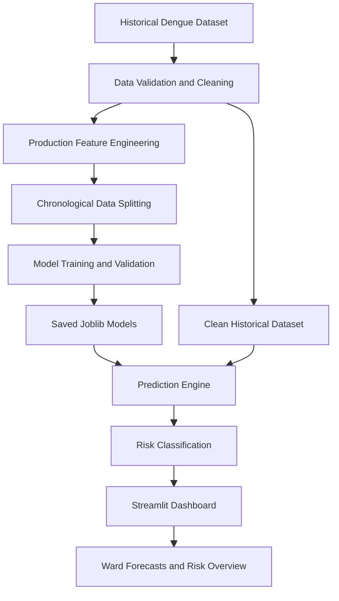

# DengueGuard AI — System Architecture

PROJECT OVERVIEW

DengueGuard AI is an AI-powered, ward-level dengue forecasting system designed to estimate dengue cases 2, 3, and 4 weeks ahead across 60 wards in five urban areas of Bangladesh.

The system combines historical dengue cases, weather conditions, rainfall patterns, and environmental vulnerability indicators to generate ward-level forecasts and classify dengue risk into four categories: Low, Medium, High, and Critical.

The project uses locally trained machine learning models, a prediction engine, and an interactive Streamlit dashboard to support data-driven dengue risk monitoring.

The primary objectives are:

- Forecast dengue cases at ward level for multiple future horizons.
- Identify potentially vulnerable wards.
- Analyze rainfall patterns and delayed rainfall effects.
- Present predictions through an interactive dashboard.
- Minimize unnecessary computation and external API costs.

SYSTEM DATA FLOW

The overall system follows this architecture:


<div style="page-break-before: always;"></div>
The pipeline consists of the following stages:

1. Data ingestion: Load the historical Excel dataset.
2. Preprocessing: Validate records, regularize weekly observations, handle missing values, and generate a cleaned dataset.
3. Feature engineering: Generate weather features, rainfall lags, rolling rainfall sums, static environmental indicators, calendar features, and previous-week dengue case history.
4. Model training: Train separate machine learning models for 2-, 3-, and 4-week forecast horizons.
5. Model persistence: Save trained models locally using Joblib.
6. Prediction: Load saved models and generate forecasts for individual wards or all available wards.
7. Risk classification: Convert predicted case counts into four risk categories.
8. Visualization: Display forecasts, risk distributions, and environmental indicators through the Streamlit dashboard.

DATASET AND PREPROCESSING

The project uses the hackathon-provided historical dataset:

`data/raw/hackathon_preli_dataset.xlsx`

Dataset coverage:

| Attribute | Description |
|---|---|
| Observations | 31,320 weekly records |
| Geographic coverage | 60 wards |
| City areas | 5 |
| Historical period | 2016–2025 |
| Observation frequency | Weekly |
| Main target | Dengue cases |

The five city areas are:

- Chattogram
- Dhaka North
- Dhaka South
- Gazipur
- Narayanganj

The dataset includes:

- Weekly dengue case counts.
- Average, maximum, and minimum temperatures.
- Rainfall measurements.
- Relative humidity.
- Population density.
- Waterlogging risk index.
- Sanitation score.

The preprocessing pipeline performs:

- Numeric data validation.
- Date and ward-key validation.
- Duplicate ward-date detection and removal.
- Weekly date-grid regularization.
- Causal handling of missing observations.
- Data quality reporting.
- Cached access to the cleaned dataset.

The cleaned dataset is stored locally under `data/processed/`.

FEATURE ENGINEERING

The production feature pipeline uses 25 features grouped into five categories.

| Feature group | Number of features |
|---|---:|
| Current-week weather | 5 |
| Rainfall lags and rolling sums | 10 |
| Environmental vulnerability | 3 |
| Calendar and seasonal features | 3 |
| Historical dengue case features | 4 |
| Total | 25 |

Weather features represent current-week temperature, rainfall, and humidity conditions.

Rainfall features include:

- Rainfall lags from 0 to 6 weeks.
- Rolling rainfall sums over 2 weeks.
- Rolling rainfall sums over 4 weeks.
- Rolling rainfall sums over 6 weeks.

Environmental vulnerability features include population density, waterlogging risk, and sanitation score.

Calendar features represent seasonal patterns through month-based cyclical features and dengue-season information.

Historical dengue features use only previous observations:

- Dengue cases at t-1.
- Dengue cases at t-2.
- Dengue cases at t-3.
- Mean dengue cases over the previous four weeks.

The current week's dengue case count is deliberately excluded from production features to reflect the operational assumption that it may not yet be available when a forecast is issued.

Rainfall lag features are included to capture delayed relationships between rainfall patterns and dengue transmission.

CHRONOLOGICAL DATA SPLITTING AND LEAKAGE PREVENTION

The dataset covers 2016–2025.

The project uses chronological splitting rather than random splitting to preserve the temporal structure of dengue observations.

| Dataset split | Period | Purpose |
|---|---|---|
| Training | 2016–2021 | Model fitting |
| Validation | 2022–2023 | Model selection |
| Test | 2024–2025 | Reserved for final evaluation |

The test period is excluded from production model training and model selection.

Leakage prevention measures include:

- Chronological separation of training, validation, and test periods.
- Forecast targets represent dengue cases in the same ward at the specified future horizon.
- Historical dengue features use observations only up to t-1.
- Future observations are not used to construct prediction features.
- The test period is not used to select production model configurations.
- Independent checks examine rainfall lag calculations, future invariance, and truncation invariance.

These measures help ensure that the forecasting process reflects information that would reasonably be available when a prediction is issued.

MODEL TRAINING AND SELECTION

The production system trains separate HistGradientBoostingRegressor models for each forecast horizon:

- 2-week forecast.
- 3-week forecast.
- 4-week forecast.

Two candidate HistGradientBoosting configurations are evaluated using training and validation data.

Model selection prioritizes validation in-season RMSE, followed by overall validation RMSE.

The smaller HistGradientBoosting configuration was selected for all three production horizons.

Production validation results:

| Forecast horizon | In-season MAE | In-season RMSE |
|---|---:|---:|
| 2 weeks | 2.571 | 3.663 |
| 3 weeks | 2.829 | 3.902 |
| 4 weeks | 3.484 | 4.654 |

These metrics represent validation performance, not final test-set performance.

MODEL PERSISTENCE AND PREDICTION ENGINE

The trained models are serialized using Joblib and stored locally:

```text
models/
└── production/
    ├── dengue_h2_model.joblib
    ├── dengue_h3_model.joblib
    ├── dengue_h4_model.joblib
    └── training_summary.json
```

The prediction engine is implemented in `src/predict.py`.

It supports two main prediction operations:

Individual ward prediction:

- Accepts a ward identifier.
- Selects the appropriate historical observation.
- Builds production features.
- Loads the corresponding trained models.
- Generates predictions for all three forecast horizons.
- Assigns risk categories.

All-ward prediction:

- Builds production features once.
- Selects the latest available observation for each ward.
- Processes predictions in batches.
- Loads each horizon model once per batch operation.
- Generates forecasts for all 60 wards.
- Returns the results with city information and risk categories.

Predicted case counts are clipped at zero to prevent negative forecasts.

RISK CLASSIFICATION

Predicted dengue cases are converted into four risk categories using provisional thresholds derived from nonzero in-season training-period case-count quantiles.

| Risk category | Predicted cases |
|---|---|
| Low | Below 3 |
| Medium | 3 to below 6 |
| High | 6 to below 10 |
| Critical | 10 or above |

The thresholds are model-based project thresholds and are not official public-health alert standards.

The risk classification system is implemented in `src/risk.py`.

COMPUTE AND API COST EFFICIENCY

DengueGuard AI prioritizes local inference, reusable computations, and caching to minimize unnecessary computation and external service costs.

1. Local model inference

- Three trained machine learning models are serialized using Joblib.
- Models are stored locally and loaded for prediction instead of being retrained during dashboard interactions.
- Predictions are generated locally without an external prediction API.
- Local model inference avoids per-prediction charges from hosted machine learning services.

2. Batch processing and reusable computations

- All-ward forecasts are generated in batches.
- Production features are generated once and reused across ward-level predictions.
- Each forecast horizon model is loaded once per all-ward batch operation.
- This reduces repeated feature generation and unnecessary model-loading operations.

3. Streamlit caching

- Streamlit caching is used for cleaned dataset loading.
- All-ward forecast results are cached to avoid unnecessary repeated prediction calculations.
- Cached results reduce repeated data processing and model inference during dashboard interactions.

4. External API minimization

- The application uses the locally stored historical dataset.
- No external weather API calls are required during local inference.
- No external prediction API is required.
- Forecast generation does not depend on paid cloud inference services.

5. LLM token and cost controls

- No LLM API is integrated into the production forecasting pipeline.
- No LLM prompts are generated during prediction.
- Forecast generation therefore incurs zero LLM token usage and zero LLM API charges.
- Prediction results are generated by locally stored machine learning models rather than external generative AI services.


If external APIs or LLM services are introduced in future versions, request caching, rate limits, token limits, controlled request frequency, and usage monitoring should be implemented to manage operational costs.

Efficiency design goal:

The system prioritizes local execution, serialized models, batch prediction, reusable features, and cached results to keep inference fast, reproducible, and inexpensive.

APPLICATION INTERFACE

The application is built using Streamlit and Plotly.

The current dashboard provides:

- Dataset coverage and latest observation date.
- Bangladesh-wide ward risk overview.
- City and forecast-horizon filters.
- Risk distribution metrics and charts.
- Ward-level prediction tables.
- Individual ward forecasting.
- Weather and environmental indicators.
- Forecast comparison charts.

The dashboard uses the locally stored dataset and trained models.

The application does not require an external API key for local prediction.

PROJECT STRUCTURE

```text
DengueGuard-AI/
├── app.py
├── requirements.txt
├── README.md
├── ARCHITECTURE.md
├── CONTRACT.md
├── data/
│   ├── raw/
│   └── processed/
├── models/
│   └── production/
├── src/
├── tests/
└── assets/
```

LIMITATIONS AND FUTURE IMPROVEMENTS

Current limitations:

- Forecasts depend on the quality and availability of historical input data.
- The latest available dataset observation is dated 29 December 2025.
- Predictions are based on historical observations, not live 2026 weather or dengue reports.
- Risk thresholds are provisional and require public-health validation.
- Forecasts are estimates and should not be treated as official public-health alerts.
- The current system does not automatically retrieve live weather or dengue surveillance data.

Potential future improvements:

- Integration of reliable live weather and public-health data sources.
- Additional geographic visualization and ward-level heatmaps.
- Forecast uncertainty estimation.
- Further validation using independent historical and future datasets.
- Public-health expert review of risk thresholds.
- Multilingual dashboard support and improved accessibility.

FINAL NOTE

DengueGuard AI is an educational hackathon project designed to demonstrate how historical dengue surveillance, weather patterns, rainfall lag features, environmental vulnerability indicators, and machine learning can support ward-level dengue forecasting in Bangladesh.

Its predictions are intended for research, demonstration, and decision-support purposes. They should not replace official public-health surveillance, medical advice, or government-issued dengue alerts.