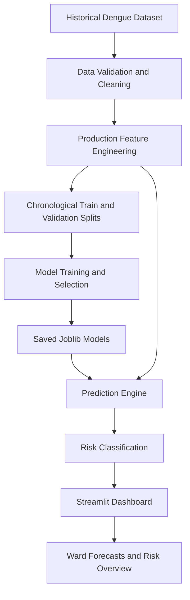

# DengueGuard AI — System Architecture

## 1. Project Overview

DengueGuard AI is a ward-level dengue forecasting system designed to estimate dengue cases 2, 3, and 4 weeks ahead across 60 wards in five Bangladeshi city areas.

The system combines historical dengue cases, weather conditions, rainfall patterns, and environmental vulnerability indicators to generate forecasts and classify risk into four categories: Low, Medium, High, and Critical.

The application uses locally stored machine learning models and a Streamlit dashboard.

## 2. System Data Flow

The pipeline consists of the following stages:

1. **Data ingestion:** Load the historical Excel dataset.
2. **Preprocessing:** Validate data, regularize weekly observations, and handle missing values.
3. **Feature engineering:** Generate weather features, rainfall lags, rolling rainfall sums, static environmental indicators, calendar features, and previous-week dengue case history.
4. **Training:** Train separate forecasting models for 2-, 3-, and 4-week horizons.
5. **Model persistence:** Save trained models using Joblib.
6. **Prediction:** Load saved models and generate forecasts for individual wards or all wards.
7. **Risk classification:** Convert predicted case counts into risk categories.
8. **Visualization:** Display forecasts, risk distributions, and environmental indicators in Streamlit.

## 3. Feature Engineering

The production pipeline uses 25 features:

- 5 current-week weather features.
- 10 rainfall lag and rolling-sum features.
- 3 static environmental vulnerability features.
- 3 calendar features.
- 4 historical dengue case features.

Historical dengue features use only previous observations:

- Dengue cases at t-1.
- Dengue cases at t-2.
- Dengue cases at t-3.
- Mean dengue cases over the previous four weeks.

The current week's dengue case count is deliberately excluded from production features to reflect the operational assumption that it may not yet be available when a forecast is issued.

Rainfall lag features capture delayed relationships between rainfall and dengue transmission.

## 4. Chronological Data Splitting and Leakage Prevention

The dataset covers 2016–2025.

The project uses chronological splitting:

| Dataset Split | Period | Purpose |
|---|---|---|
| Training | 2016–2021 | Model fitting |
| Validation | 2022–2023 | Model selection |
| Test | 2024–2025 | Reserved for final evaluation |

The test period is excluded from production model training and model selection.

Target labels represent dengue cases in the same ward at the specified future horizon.

Feature engineering uses information available at or before the forecast issue date. Historical dengue case features stop at t-1.

Independent checks verify weekly data consistency, rainfall lag calculations, future invariance, and truncation invariance.

## 5. Model Selection

The production system trains separate HistGradientBoostingRegressor models for each forecast horizon:

- 2-week forecast.
- 3-week forecast.
- 4-week forecast.

Two candidate configurations are evaluated using training and validation data.

Model selection prioritizes validation in-season RMSE, followed by overall validation RMSE.

The smaller HistGradientBoosting configuration was selected for all three production horizons.

| Horizon | Validation In-Season MAE | Validation In-Season RMSE |
|---|---:|---:|
| 2 weeks | 2.571 | 3.663 |
| 3 weeks | 2.829 | 3.902 |
| 4 weeks | 3.484 | 4.654 |

These are validation results, not final test-set performance.

## 6. Risk Classification

Predicted dengue cases are converted into four risk categories using provisional thresholds derived from nonzero in-season training-period case-count quantiles.

| Risk Category | Predicted Cases |
|---|---|
| Low | Below 3 |
| Medium | 3 to below 6 |
| High | 6 to below 10 |
| Critical | 10 or above |

These thresholds are model-based project thresholds and are not official public-health alert standards.

## 7. Inference Efficiency and API Cost Control

DengueGuard AI prioritizes local inference to minimize unnecessary external service costs.

- Trained models are stored locally using Joblib.
- Models are loaded from disk instead of retraining during dashboard interactions.
- All-ward predictions build production features once and process wards in batches.
- Streamlit caching avoids repeated data loading and all-ward prediction calculations.
- No external weather API calls are required during local inference.
- No LLM API calls are required for prediction generation.

This design reduces network dependencies, recurring API costs, and prediction latency.

## 8. Application Interface

The Streamlit dashboard provides:

- Dataset coverage and latest observation date.
- Bangladesh-wide ward risk overview.
- City and forecast-horizon filters.
- Risk distribution metrics and charts.
- Ward-level prediction tables.
- Individual ward forecasting.
- Weather and environmental input indicators.
- Forecast comparison charts.

The application supports local execution using the saved dataset and trained models.

## 9. Limitations

- Forecasts depend on the quality and availability of historical input data.
- The latest available dataset observation is dated 29 December 2025; predictions are based on that historical observation, not live 2026 conditions.
- Risk thresholds are provisional and require public-health validation.
- Forecasts are estimates and should not be treated as official public-health alerts.