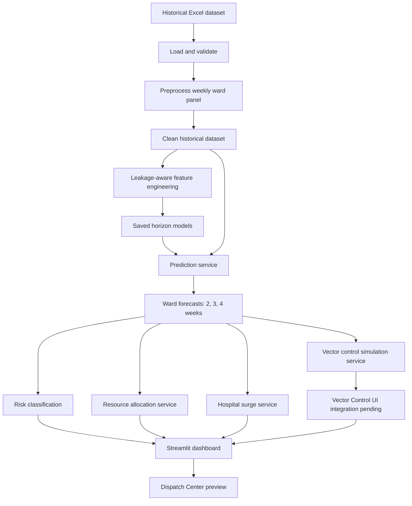

# DengueGuard AI — System Architecture

**Team:** HackSync  
**Project:** EDU AI Engineering Hackathon 2026  
**Application:** https://dengueguard-ai.streamlit.app/  
**Repository:** https://github.com/sifata68-bit/DengueGuard-AI  
**Documentation checkpoint:** 27 November 2026

## 1. System overview

DengueGuard AI is a ward-level dengue forecasting and operational decision-support application for five urban areas and 60 wards in Bangladesh. The forecasting engine generates 2-, 3-, and 4-week dengue case estimates using locally trained machine-learning models. A Streamlit application presents forecasts and operational planning interfaces.

The architecture has three layers:

1. **Data and forecasting:** load and validate historical data, engineer leakage-aware features, and generate forecasts using saved models.
2. **Decision-support services:** apply risk prioritization and scenario-based calculations for resource allocation, hospital surge, and vector-control simulation.
3. **Presentation:** expose forecasting and operational information through Streamlit pages.

The application performs local inference. The forecasting workflow does not require an external weather, dengue-prediction, or LLM API.

## 2. High-level data flow



Phase 2 backend and frontend integration has been merged into `main`. The Resource Allocation and Hospital Surge interfaces are part of the integrated application. The Vector Control simulation backend is implemented and tested, but the current Streamlit Vector Control page remains a preview and is not yet connected end-to-end to the simulation service. The Dispatch Center remains a preview with generation disabled.

## 3. Data sources and preprocessing

### Source data

The primary input is `data/raw/hackathon_preli_dataset.xlsx`.

| Attribute | Value |
|---|---|
| Weekly records | 31,320 |
| Wards | 60 |
| Urban areas | 5 |
| Historical coverage | 2016–2025 |
| Target | Weekly dengue cases |

The five urban areas are Chattogram, Dhaka North, Dhaka South, Gazipur, and Narayanganj.

The source includes dengue counts, weather measurements, rainfall, relative humidity, population density, waterlogging risk, and sanitation indicators.

### Processing path

- `src/data_loader.py` loads and validates source records.
- `src/preprocessing.py` prepares the cleaned weekly ward dataset.
- The processed dataset is stored under `data/processed/` and is excluded from version control.
- The latest source observation is dated 29 December 2025; forecasts do not incorporate automatic live 2026 surveillance or weather updates.

## 4. Feature engineering and leakage control

The production pipeline uses 25 engineered features across five groups:

| Feature group | Features |
|---|---:|
| Current-week weather | 5 |
| Rainfall lags and rolling values | 10 |
| Environmental vulnerability | 3 |
| Calendar and seasonal | 3 |
| Historical dengue | 4 |
| **Total** | **25** |

Rainfall features include lags and rolling sums. Historical dengue features use previous observations only. Current-week dengue cases are excluded from production features.

The dataset is split chronologically:

| Split | Period | Use |
|---|---|---|
| Training | 2016–2021 | Model fitting |
| Validation | 2022–2023 | Model selection |
| Test | 2024–2025 | Held-out evaluation |

The test period is not used for model selection. Leakage checks cover temporal feature construction and lag behavior.

## 5. Forecasting models

Separate `HistGradientBoostingRegressor` models are stored for the 2-, 3-, and 4-week horizons:

```text
models/
└── production/
    ├── dengue_h2_model.joblib
    ├── dengue_h3_model.joblib
    └── dengue_h4_model.joblib
```

The prediction pipeline in `src/predict.py` loads these artifacts and generates ward-level predictions. The application uses local Joblib inference rather than training models during normal dashboard interactions.

### Validation performance

| Horizon | MAE | RMSE |
|---|---:|---:|
| 2 weeks | 1.232 | 2.431 |
| 3 weeks | 1.361 | 2.602 |
| 4 weeks | 1.678 | 3.115 |

These are validation regression metrics. They are not classification accuracy and are not claimed as held-out test results.

## 6. Risk classification

Predicted cases are mapped to Low, Medium, High, or Critical risk categories. Thresholds are derived from training-period in-season nonzero case-count quantiles.

These thresholds are project-specific and are not official public-health alert thresholds. The forecast target is a single future week's case count, not a cumulative multi-week total.

## 7. Operational decision-support services

### 7.1 Resource Allocation — `src/resource_allocation.py`

The allocation service accepts:
- Forecasts for a selected horizon.
- Ward metadata, including city and population density.
- City-level inventory for saline bags and diagnostic kits.
- Per-case demand parameters with source and provenance status.
- A stock-availability percentage.
- Optional spraying-crew limits by city.

Wards are prioritized by risk category, then population density, with ward ID as a stable tie-breaker. Available stock is allocated according to the service's priority ordering. The result includes ward allocations, city/regional summaries, resource totals, shortages, and crew assignment summaries.

Demand ratios are operational inputs, not universal medical standards. The service validates parameter provenance and numeric constraints; it does not verify the real-world correctness of a user-supplied ratio.

### 7.2 Hospital Surge — `src/hospital_surge.py`

The hospital service exposes:
- `assess_hospital_surge(forecasts, hospital_capacity, ...)`
- `generate_overflow_plan(surge_assessment)`

It compares forecast-derived estimated bed demand with actual available-bed capacity supplied for each ward. It calculates spare beds, excess demand, utilization, and a surge status. The overflow planner recommends same-city transfers from wards with spare capacity to wards with excess demand and reports any remaining unmet demand.

The default `DEFAULT_BEDS_PER_CASE = 0.253` is a scenario assumption, not a clinically validated standard. Hospital capacity must come from operator-provided capacity data; estimated bed demand must never be treated as capacity. Suggested transfers are planning outputs, not confirmed transfers.

### 7.3 Vector Control — `src/vector_control.py` and `src/vector_control_service.py`

The vector-control service obtains ward forecasts and passes them to the simulator. The simulator validates scenario inputs, prioritizes wards by risk and population density, assigns up to the supplied team limit, and estimates baseline versus scenario cases and related resource savings for the selected intervention and forecast horizons.

Intervention effectiveness is an operator-supplied scenario assumption. The historical dataset does not contain intervention histories and measured outcomes sufficient to learn causal fogging or larvicide effectiveness. Simulated impact is not a causal estimate or a guarantee of cases prevented.

**Integration status:** the backend service and tests are implemented. The current Streamlit Vector Control page is still a preview and does not yet invoke the service end-to-end.

### 7.4 Dispatch Center

The current Dispatch Center page is a UI preview. Its generation action is disabled. Automated SMS, WhatsApp, PDF, or HTML dispatch should not be described as operational functionality.

## 8. Streamlit presentation layer

The entry point is `app.py`. It loads the cleaned dataset and connects the forecasting pipeline to dashboard pages.

The integrated interface includes the forecasting dashboard, Resource Allocation, and Hospital Surge workflows. Vector Control and Dispatch Center are currently preview interfaces, with their limitations described above.

Streamlit and Plotly provide interactive presentation. The app does not require an external API key for local model inference.

## 9. Validation and testing checkpoint

Tests are maintained under `tests/`. The suite covers data validation and preprocessing, feature engineering and leakage checks, predictions, resource allocation, hospital surge, and vector-control simulation/service behavior.

On 27 November 2026, after the Phase 2 integration merge into `main`, the team ran:

```text
214 passed in 27.85s
```

The team also manually confirmed that the local Streamlit application pages loaded during a browser smoke check and reported that the deployed application was working. These are recorded checkpoint results; re-run tests and verify deployment after subsequent changes.

## 10. Repository structure

```text
DengueGuard-AI/
├── app.py
├── requirements.txt
├── README.md
├── ARCHITECTURE.md
├── data/
│   ├── raw/
│   └── processed/
├── models/
│   └── production/
├── src/
│   ├── config.py
│   ├── data_loader.py
│   ├── preprocessing.py
│   ├── feature_engineering.py
│   ├── predict.py
│   ├── risk.py
│   ├── hospital_surge.py
│   ├── resource_allocation.py
│   ├── vector_control.py
│   └── vector_control_service.py
└── tests/
```

Generated processed data, local virtual environments, Python bytecode, test caches, and temporary backup copies are excluded through `.gitignore`.

## 11. Limitations and safe interpretation

- The dataset ends on 29 December 2025; no live data feed is configured.
- Forecasts depend on historical data quality and coverage.
- Risk thresholds are project-specific and need public-health expert review.
- Resource demand ratios and bed-demand ratios are assumptions or operator inputs, not validated clinical standards.
- Hospital capacity must be supplied as actual available capacity.
- Overflow recommendations do not confirm staff, transport, or bed availability.
- Vector-control effectiveness is scenario-supplied and is not causally learned from intervention outcome data.
- The Vector Control page is not yet connected end-to-end to its simulation backend.
- Dispatch Center generation and external messaging are not operational.

DengueGuard AI is an educational hackathon decision-support project. It must not replace official surveillance, public-health guidance, clinical judgment, or government-issued alerts.
